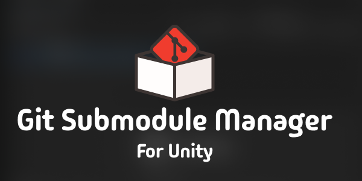

<p align="center">
  
</p>

# Git Submodule Manager

See which installed Unity packages are Git submodules and where your packages
come from, directly in Unity's Package Manager.

<p align="center">
  <a href="https://github.com/martincalander/GitSubmoduleForUnity/actions/workflows/ci.yml"></a>
  <a href="https://github.com/martincalander/GitSubmoduleForUnity/releases"></a>
  
  <a href="LICENSE.md"></a>
</p>

The focus is small: **installed package status and sources**. `main` contains
this simplified version. The previous manager, including remote discovery,
installation, conversion, and removal workflows, is preserved on
[`legacy`](https://github.com/martincalander/GitSubmoduleForUnity/tree/legacy).

## What You Get

- **Submodule** labels for installed package submodules.
- **Repository** as the first link beside Unity's Documentation, Changelog, and
  Licenses links when a safe repository URL is available.
- **Sources > GitHub** for the project's installed GitHub submodules and UPM Git
  dependencies, using Unity's native package list, search, and selection.
- Protection against Unity deleting a Git checkout as an ordinary embedded
  package folder.

Use Unity to manage ordinary packages and Git to manage submodules. Status
shows how a package is installed; it does not indicate whether local changes
are committed, pushed, or up to date.

## Install the Current Version

In **Window > Package Management > Package Manager**, choose **+ > Install
package from git URL...** and enter:

```text
https://github.com/martincalander/GitSubmoduleForUnity.git#main
```

For a reproducible project, replace `main` with the commit you have tested.
Local checkouts and submodule installations are covered in the
[installation guide](Documentation~/installation.md).

The simplified version on `main` has not been published as a new release yet.
Existing `0.8.1` downloads, OpenUPM packages, and the bundled bootstrap contain
the earlier workflow. Use the Git URL above or a current local checkout for the
simplified version, including Unity 7.

## Use It

1. Open **Window > Package Management > Package Manager**.
2. Look for **Submodule** labels on installed package submodules.
3. Choose **Sources > GitHub** for installed GitHub packages.
4. Select an installed package and use **Repository** in its links row to open
   the repository when the link is available.
5. After changing submodules with Git, let Unity finish importing and refresh
   Package Manager.

Package status and the GitHub source read local installed state. They do not
browse your GitHub account, contact GitHub, or require GitHub CLI or account
setup. An empty GitHub list is expected when no installed package uses GitHub.
The Repository link uses the same cached installed state and adds no remote
checks.

## Editor Overhead

The extension has no continuous window scan or remote discovery. Closing
Package Manager releases its status observers and scheduled attachment work,
cancels an active local read, and stops its update callback when that read drains.
While open, it checks Git metadata every two seconds; ordinary asset edits do not
trigger Git reads, and unchanged status does not rebuild package views.

Native integration checks are cached, sidebar icons use 64-pixel imports, and
the unused Newtonsoft dependency has been removed. Measurements show lower
allocation and icon-memory costs; isolated startup measurements did not establish
a meaningful Editor launch speedup. See the
[performance measurements](.github/CONTRIBUTING.md#performance-verification-on-2026-10-19).

## Unity Compatibility

See the [verification records](.github/CONTRIBUTING.md) for the exact commits,
Unity versions, platforms, and checks exercised locally. These records distinguish
prior status-view validation from subsequent feature changes.

The compatibility gate retains exact Unity `6000.3.22f1`, `6000.5.*f1` final
releases, exact `6000.6.0f1` and `6000.6.2f1`, exact `6000.7.0b1` and
`6000.7.0b2` betas, and exact `7000.0.0a7`, `7000.0.0a8`, `7000.0.0a9`, and
`7000.0.0a10` alphas. Other versions remain unsupported. Consult the verification
records for targets not yet retested with these changes. The package is
Editor-only.

## Moving from the Earlier Manager

The [`legacy` branch](https://github.com/martincalander/GitSubmoduleForUnity/tree/legacy)
preserves the former `main` and its fuller management workflow. Existing
`v0.8.1` releases remain available. Switching to the simplified version leaves
your installed packages in place, but removes the previous management actions.

Finish pending operations before switching and retain any recovery files until
you have inspected them. See the [migration guidance](Documentation~/user-guide.md#moving-from-legacy-to-main)
and [legacy documentation](https://github.com/martincalander/GitSubmoduleForUnity/blob/legacy/Documentation~/index.md).

## Documentation

- [Installation and compatibility](Documentation~/installation.md)
- [User guide](Documentation~/user-guide.md)
- [Troubleshooting](Documentation~/troubleshooting.md)
- [Architecture and safety model](Documentation~/architecture.md)
- [Roadmap](Documentation~/roadmap.md)
- [Changelog](CHANGELOG.md)
- [Contributing](.github/CONTRIBUTING.md)
- [Support](.github/SUPPORT.md)

## License

Distributed under the [MIT License](LICENSE.md). See
[Third Party Notices](Third%20Party%20Notices.md), [NOTICE.md](NOTICE.md), and
[AUTHORS.md](AUTHORS.md) for attribution.

## Games Made Using This Package

| [](https://store.steampowered.com/app/4372950/Cave_Expedition/) | [](https://store.steampowered.com/app/1680780/Big_Boy_Boxing/) |
| :---: | :---: |
| [**Cave Expedition**](https://store.steampowered.com/app/4372950/Cave_Expedition/) | [**Big Boy Boxing**](https://store.steampowered.com/app/1680780/Big_Boy_Boxing/) |

Made a game using this package? Email
[martin.calander@gmail.com](mailto:martin.calander@gmail.com) to have it added
to the showcase.
